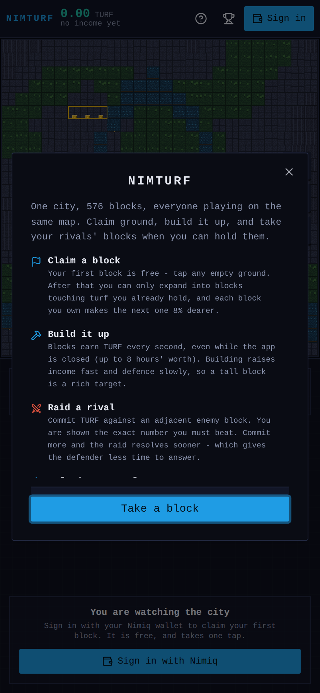
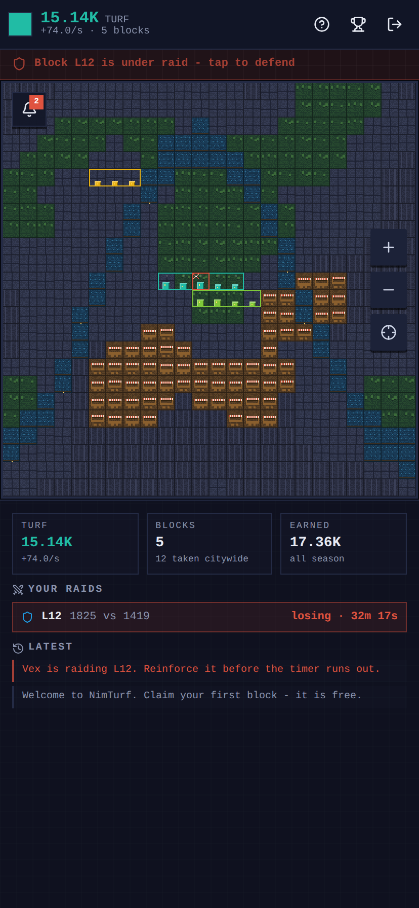
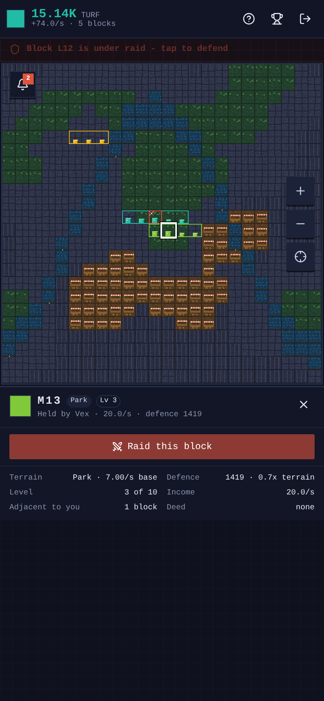
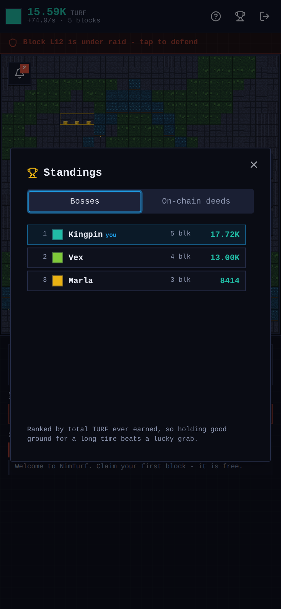

# NimTurf

**A deterministic pixel-art turf war for [Nimiq Pay](https://nimiq.com/pay/).**
One city. 576 blocks. Everyone plays the same map.

Claim ground, build it up, and take your rivals' blocks when you can hold them.
Your territory earns TURF every second, whether the app is open or not — and
when you want a block that somebody else holds, you raid it.

> **No dice. Ever.** Nothing in NimTurf is decided at random. A raid is a
> public, timed contest of committed resources that either side can compute
> exactly, at any moment. You win by picking better targets and better timing,
> never by getting lucky. See [Determinism by design](#determinism-by-design).

| First run | The city | A block | Standings |
|---|---|---|---|
|  |  |  |  |

---

## Why NimTurf

Idle games are good at giving you a reason to come back. Strategy games are
good at giving you something to think about. Most idle games have nothing to
think about, and most strategy games demand an uninterrupted hour.

NimTurf is built for the way a payment app actually gets opened: for thirty
seconds, several times a day. In thirty seconds you can bank your income,
claim a block, or answer a raid that has been ticking down while you were out.
The interesting decisions — which ground to take, how compact to stay, how
much to commit to a fight — survive being made in short bursts, because
nothing is hidden and nothing is random.

## How Nimiq is core to it

This is not a web game with a wallet button bolted on. Nimiq does three jobs
that nothing else in the app does.

### 1. Your wallet is your account

There are no passwords, no email, no sign-up form. You prove you hold a Nimiq
address by signing a one-time challenge, and that address *is* your identity
and your territory.

- **Inside Nimiq Pay**, the injected mini-app provider signs the challenge.
- **In a desktop browser**, the same flow runs through the
  [Nimiq Hub](https://hub.nimiq.com).

Both paths produce the same thing, and the server verifies it the same way —
see [`web/src/lib/wallet.ts`](web/src/lib/wallet.ts).

The signature is verified server-side: the public key is hashed to an address
and compared with the address being claimed, so presenting a valid signature
alongside somebody else's address fails. Challenges are single-use, so a
signature cannot be replayed.

### 2. Deeds are recorded on the Nimiq blockchain

A **deed** makes a block raid-proof for seven days and raises its income by
25%. It costs 2 NIM, and it works like this:

1. The server quotes the exact payment, including a data field like
   `NIMTURF:1:S1:319` — format version, season, tile.
2. Your wallet sends that NIM transaction, with the claim written into the
   transaction's own data field.
3. The server looks the transaction up **on the Nimiq network** and checks the
   sender, the recipient, the amount and the data field before granting
   anything.

So a deeded block is not a row in our database that we ask you to trust. The
claim is on a public chain, and the **On-chain deeds** tab in the app links
every deed straight to a block explorer so anyone can check it. One
transaction can only ever be redeemed once.

Deeds are a **utility purchase, not a wager**: the price is fixed, the effect
is identical for everyone, and there is no payout. You also **cannot deed a
block that is under raid** — NIM buys permanence in peacetime, never a rescue
from a fight you are losing.

### 3. NIM, natively

NimTurf settles in NIM through Nimiq's own transaction methods, not through a
bridged token. The whole economy of the game runs on ordinary Nimiq basic
transactions with a data field — the simplest thing the chain does, used for
what it is actually good at.

## How to play

| | |
|---|---|
| **Claim** | Your first block is free. After that you can only expand into blocks touching turf you already hold, and every block you own makes the next one 8% dearer — so sprawl is self-limiting. |
| **Build** | Blocks earn TURF every second, including while closed (capped at 8 hours). Building raises income *fast* and defence *slowly*, so a tall block is a rich target. |
| **Raid** | Commit TURF against an adjacent enemy block. You are shown the exact number you must beat. Commit more and it resolves sooner — which leaves the defender less time to answer. |
| **Defend** | You are told the moment one of your blocks is raided, and by how much. Out-commit the attacker before the timer ends and you keep the block *and* 70% of what you spent. |
| **Deed** | Pay 2 NIM to make a block raid-proof for a week and earn 25% more, recorded on-chain. |

Terrain is the standing trade-off. Markets pay the most and defend the worst;
tower blocks are fortresses that earn little; the waterfront is valuable and
sits on the map's natural chokepoints. Compact territory beats scattered
territory, because each adjacent block you own adds +12% income.

## Determinism by design

The competition rules disallow games of chance, and this one takes that as a
design principle rather than a constraint to work around.

- **No RNG in any rule.** There is no random number generator anywhere in the
  game logic. A raid resolves by comparing two committed numbers.
- **No hidden information.** The defender sees the attacker's commitment and
  the exact threshold immediately. Both sides can compute the outcome at any
  moment; the UI states it in words before you commit.
- **Ties favour the defender**, so an outcome is never arbitrary.
- **A failed raid refunds 40%**, so losing hurts without ending your game.
- **The map is generated once per season** from a public seed and is fully
  visible before anyone moves — like the board of a strategy game, not a deal
  of cards.

Terrain is assigned by *rank*, in fixed proportions, rather than by absolute
noise thresholds. An earlier version keyed the rare terrains off the tail of a
noise field, which produced seasons with only a handful of market tiles — the
highest-yielding ground — and so handed out materially different games before
anyone had moved. Every season now offers the same strategic menu in a
different arrangement. There is a test that asserts this across 60 seeds:
[`packages/shared/test/worldgen.test.ts`](packages/shared/test/worldgen.test.ts).

## Architecture

```
packages/shared/   Game rules. Pure, integer-only, no I/O.
worker/            Cloudflare Worker: API + authoritative game state + static hosting.
web/               Vite + React + Tailwind + shadcn/ui client.
scripts/           End-to-end checks, demo seeding, screenshots.
```

Three decisions carry most of the weight.

**One rules module, shared verbatim.** `packages/shared` holds every constant
and every formula, and both the browser and the server import the same file.
The client can therefore show you the exact cost of a claim, the exact
threshold of a raid and a smoothly ticking balance, and be certain the server
will agree — because it is running the identical function. The economy is
integers and basis points throughout, so there is no floating-point drift
between the two.

**The server is the only authority.** The browser never computes a balance it
is trusted on. Income accrues lazily from timestamps, and every action banks a
player's income *at the old rate* before applying a change that alters it,
which is where idle games usually leak value.

**One SQLite-backed Durable Object per season.** Because a Durable Object
processes one request at a time against its own transactional storage, two
players cannot claim the same block or spend the same TURF twice, with no
locking anywhere in the codebase. Raids resolve on a Durable Object alarm
*and* lazily on the next read, so the world is correct when anyone looks at it
even if an alarm were delayed — the outcome is identical either way, because
it is a pure function of the committed resources.

The frontend is served by the same Worker that serves the API, so the game is
a single deployment on a single origin with no cross-origin requests at all.

### Notable implementation details

- **Nimiq address derivation is implemented directly**
  ([`packages/shared/src/address.ts`](packages/shared/src/address.ts)) rather
  than by bundling the multi-megabyte `@nimiq/core` WASM client into a Worker.
  It is cross-checked against the official client over hundreds of random
  keypairs in
  [`worker/test/nimiq-crypto.node.test.ts`](worker/test/nimiq-crypto.node.test.ts),
  so it stays a size optimisation and never a behaviour change.
- **Signature verification accepts several message encodings**, all of which
  bind the server's single-use nonce. The framework documentation does not pin
  down a wallet's exact pre-hashing and it may differ between Nimiq Pay and
  the Hub; accepting any nonce-bound encoding avoids locking out half the
  users without weakening the check.
- **The pixel art is generated in code**
  ([`web/src/lib/pixel.ts`](web/src/lib/pixel.ts)) — every sprite is drawn a
  pixel at a time into an offscreen atlas at startup. No image assets ship, it
  stays crisp at any zoom, and all of it is original work under this
  repository's licence.
- **Deed redemption retries** while the transaction is still being mined. A
  player has already paid real NIM by that point, so a slow node must never
  cost them the deed.

## Running it locally

Requires Node 20+.

```bash
npm install

# One-time: local secrets for the API.
cp worker/.dev.vars.example worker/.dev.vars

# Terminal 1 - the API and game server
npm run dev:api

# Terminal 2 - the client, with hot reload
npm run dev
```

Then open <http://localhost:5173>. Signing in from a desktop browser uses the
Nimiq Hub.

### Trying it inside Nimiq Pay

```bash
npm run dev -- --host        # note the Network URL it prints
```

In Nimiq Pay, go to **Mini Apps** and enter that `http://<your-ip>:5173`
address in the custom URL field. For transactions, use the app's Testnet mode
(long-press the settings button for ten seconds) and claim free testnet NIM.

### Seeing a populated world

```bash
node scripts/seed-demo.mjs http://127.0.0.1:8787
```

This signs in three players with genuine Ed25519 wallet signatures, gives them
neighbouring territory and starts a live raid. It goes through the ordinary
API — there is no back door in the server for it. The last line it prints is a
session token you can drop into `localStorage` under `nimturf.session` to open
the browser as that player.

## Tests

```bash
npm test              # game rules + crypto + RPC parsing  (120 tests)
npm run test:worker   # Durable Object, in real workerd     (29 tests)
npm run e2e           # full game over HTTP                 (55 checks)
npm run typecheck
```

The suites are split by what they can actually prove.

- **Rules** are pure functions, so they are tested exhaustively — including a
  sweep across a raid's entire decision boundary asserting the outcome flips
  exactly once, at the resource threshold, which is the evidence that nothing
  is left to chance.
- **Crypto** is checked against `@nimiq/core` itself, and includes the
  impersonation attack: a valid signature presented with somebody else's
  address must be rejected.
- **The Durable Object** runs in real `workerd` against real SQLite. These
  cover what HTTP tests cannot reach, because a raid takes at least five
  minutes of wall-clock time: the deadline is rewound in storage and the alarm
  invoked, exactly as the runtime does in production.
- **`scripts/e2e.mjs`** plays a real game against a running server using
  genuine wallet signatures — sign in, claim, build, raid, defend, leaderboard
  — and asserts the failure paths too: replayed nonces, tampered tokens,
  impersonation, overspending, raiding your own turf. When a Nimiq RPC
  endpoint is configured it also verifies a **real mainnet transaction** is
  fetched and then rejected on its contents, which exercises the whole on-chain
  lookup rather than only the "not found" branch.

## Deploying

Everything is one Cloudflare Worker.

```bash
npm run build                      # builds web/dist, which the Worker serves

cd worker
npx wrangler secret put SESSION_SECRET     # long random string
npx wrangler secret put TREASURY_ADDRESS   # Nimiq address that receives deed payments
npx wrangler secret put NIMIQ_RPC_URL      # Nimiq Albatross JSON-RPC endpoint
npx wrangler deploy
```

| Variable | Required | Purpose |
|---|---|---|
| `SESSION_SECRET` | yes | HMAC key for session tokens. Sign-in refuses to work without one at least 16 characters long, rather than falling back to a guessable default. |
| `TREASURY_ADDRESS` | for deeds | Nimiq address that receives deed payments. |
| `NIMIQ_RPC_URL` | for deeds | Albatross JSON-RPC endpoint used to confirm those payments. |
| `SEASON_ID` | no | Season identifier. Changing it starts a fresh world. |
| `WORLD_SEED` | no | Map seed for the season. |
| `NIMIQ_NETWORK` | no | `main` or `test`; selects the block explorer used for deed links. |
| `ALLOWED_ORIGINS` | no | Comma-separated origin allowlist. Not needed while the Worker serves the client itself. |

`GET /api/health` reports whether sign-in and deeds are correctly configured,
so a broken deployment is visible immediately instead of failing silently.

Deeds degrade gracefully: with no treasury or RPC configured the rest of the
game works and the deed action is simply not offered.

## Licence

[MIT](LICENSE). All code and all artwork in this repository is original work.

## Built for the Nimiq Mini Apps Competition

Cycle II, Games category — <https://miniappscompetition.com>

- Built on the Nimiq Pay Mini Apps Framework (`@nimiq/mini-app-sdk`), with the
  Nimiq Hub as the desktop path.
- Supports **NIM** natively, via Nimiq basic transactions with a data field.
- Nimiq wallets, signatures and transactions are the core of the experience:
  they are the login, the identity, and the on-chain deed system.
- Open source under MIT, in a public repository, with no secrets committed.
- Contains no gambling and no games of chance — see
  [Determinism by design](#determinism-by-design).
